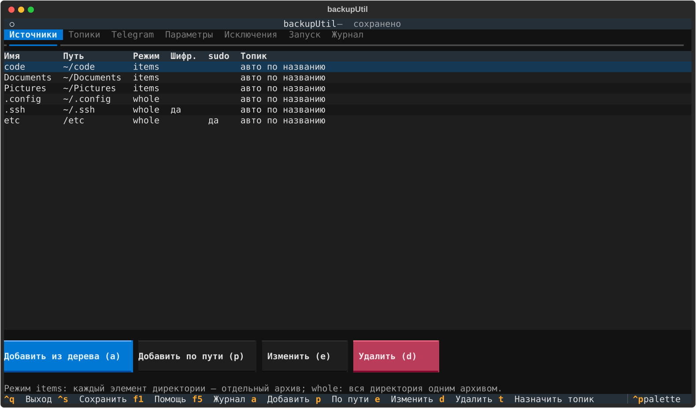
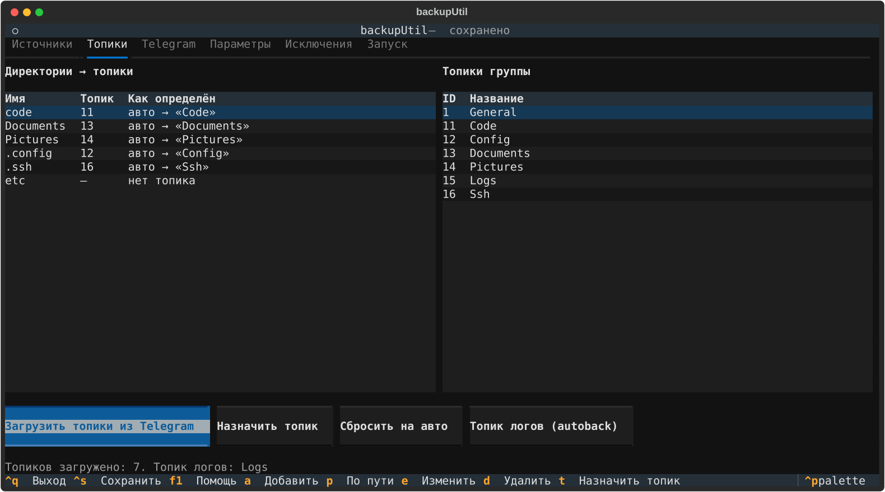
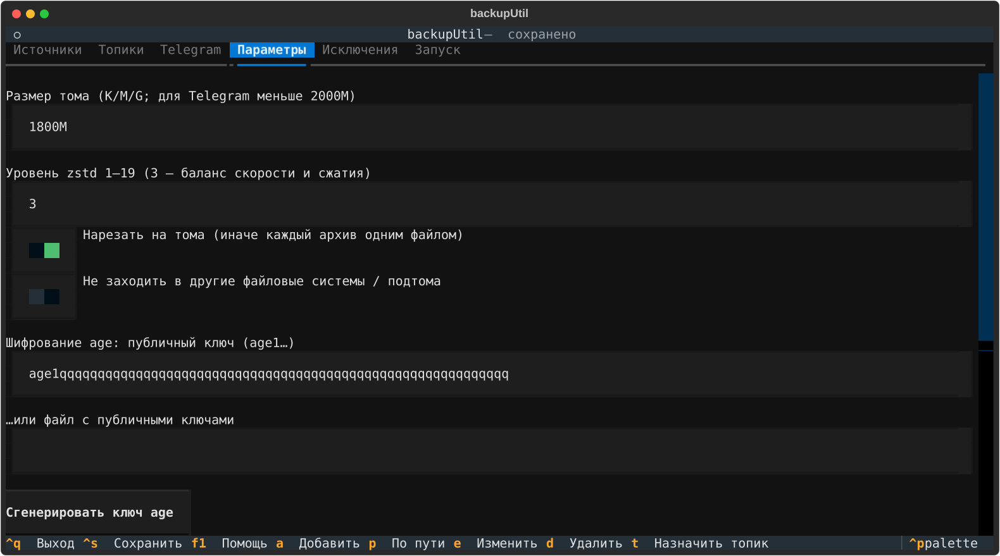
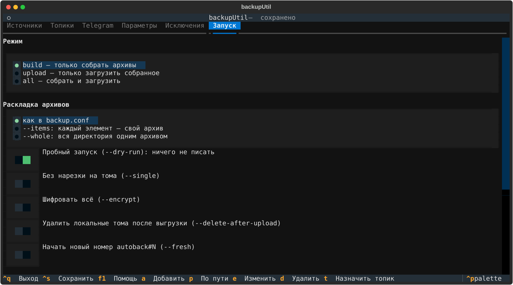

# backupUtil

**Бэкап директорий Linux в проверяемые многотомные архивы `tar.zst` (с шифрованием `age` по желанию) и выгрузка в Telegram-группу с топиками от лица вашего аккаунта. Настройка — в терминальном интерфейсе.**

[](https://github.com//backupUtil/actions/workflows/ci.yml)
[](LICENSE)




---

## Содержание

- [Зачем это нужно](#зачем-это-нужно)
- [Возможности](#возможности)
- [Быстрый старт](#быстрый-старт)
- [Как это работает](#как-это-работает)
- [Терминальный интерфейс](#терминальный-интерфейс)
- [Командная строка](#командная-строка)
- [Метки `autoback`](#метки-autoback)
- [Восстановление](#восстановление)
- [Безопасность](#безопасность)
- [Ограничения и честные оговорки](#ограничения-и-честные-оговорки)
- [Разработка и тесты](#разработка-и-тесты)
- [Документация](#документация)
- [Лицензия](#лицензия)

## Зачем это нужно

Перед миграцией на другую систему или переустановкой нужно быстро и надёжно сохранить домашние каталоги и системные конфиги, а потом так же восстановить. Telegram удобен как дополнительное хранилище, но у него свои правила: файл должен быть меньше 2 ГБ, у Bot API лимит ещё жёстче (50 МБ), а сообщения не имеют сквозного шифрования.

`backupUtil` закрывает эти ограничения:

- режет архив на тома, которые Telegram принимает, и проверяет каждый том контрольной суммой;
- загружает через **MTProto-клиент от вашего аккаунта**, а не через бота, поэтому лимит бота не действует;
- раскладывает директории по **топикам** форумной группы, а в чате остаются метки, по которым легко найти нужную «точку» бэкапа;
- по желанию шифрует архивы `age` ещё до нарезки, так что в Telegram уходит только шифртекст;
- ничего не меняет в источниках: утилита **только читает**.

> Telegram не заменяет полноценную стратегию резервного копирования (правило 3-2-1). Используйте его как одну из копий, а не как единственную.

## Возможности

| | |
|---|---|
| **Архивация** | `tar \| zstd \| split`: права, владельцы, симлинки, xattr и ACL сохраняются; пробелы и юникод в именах поддерживаются |
| **Два режима** | по умолчанию каждый элемент директории — отдельный архив; `--whole` — вся директория одним архивом |
| **Тома** | `NAME.tar.zst.000`, `.001`, … по 1800 МБ (настраивается), склеиваются обычным `cat` |
| **Целостность** | `sha256` на каждый том, `MANIFEST.txt`, проверка перед восстановлением, повреждённый том не «замолчит» |
| **Исключения** | секционный файл: общие правила `[*]` и правила для конкретной директории `[.config]` |
| **Шифрование** | `age`, опционально для отдельных директорий; сжатие идёт до шифрования, поэтому размер не страдает |
| **sudo** | для `/etc`, `/opt` и подобного: повышенные права только у `tar`, файлы архивов принадлежат вам |
| **Telegram** | вход по номеру и коду (+2FA), выбор группы и топиков, прогресс, `FloodWait`, повторы при обрыве, журнал отправленного |
| **Сопоставление топиков** | по названию, **без учёта регистра**: папка `code` попадает в топик «Code» |
| **Метки** | `07.11.2026 autoback#12` в топик логов и `autoback#12` после архивов каждой директории |
| **Безопасная пересборка** | новый набор заменяет старый только после успешной сборки |
| **TUI** | директории, топики, Telegram, параметры, исключения и запуск — в одном интерфейсе |
| **Проверки** | сухой запуск `--dry-run` с оценкой размера, проверка свободного места, блокировка от двойного запуска |

## Быстрый старт

Требования: Linux, `bash`, GNU `tar`, `zstd`, `coreutils`, Python 3.11+. Опционально: `pv` (прогресс в процентах), `age` (шифрование).

```bash
# Arch Linux; на других дистрибутивах поставьте те же пакеты
sudo pacman -S --needed zstd age pv python tar

git clone https://github.com//backupUtil.git
cd backupUtil
python -m venv .venv && .venv/bin/pip install -r requirements.txt

./backup.sh tui          # настройка: директории, Telegram, топики
```

Дальше всё делается в интерфейсе:

1. **Telegram** → `api_id` и `api_hash` с [my.telegram.org](https://my.telegram.org) (*API development tools*) → «Войти в аккаунт» → «Выбрать группу».
2. **Источники** → добавьте директории из дерева.
3. **Топики** → «Загрузить топики из Telegram». Если названия топиков совпадают с именами папок (регистр не важен), назначать ничего не нужно.
4. **Запуск** → выберите режим и нажмите «Сохранить и запустить».

То же из командной строки:

```bash
./backup.sh -n                 # пробный запуск: размеры, число архивов и томов, место на диске
./backup.sh build              # только собрать
./backup.sh upload             # только загрузить уже собранное
./backup.sh all                # собрать и загрузить (полный бэкап с метками autoback#N)
./backup.sh all code .config   # только указанные директории
```

> Рабочая папка утилиты — это папка проекта: архивы, логи и секреты лежат рядом со скриптами. Поэтому `.gitignore` устроен как **белый список**: в git попадают только файлы проекта.

## Как это работает

```
 источник ──► tar ──► zstd ──► [age] ──► split 1800M ──► <имя>.tar.zst.000, .001, …
 (только      │                                              │
  чтение)     └ sudo только здесь                            ├─► <папка>.sha256   (sha256 каждого тома)
                                                             └─► MANIFEST.txt     (дата, источник, размеры, режим)
                                                                     │
                                   tg_upload.py (Telethon, MTProto)  ▼
        топик «Code» ◄── тома по порядку, подпись «имя — N из M + sha256», затем sha256 и MANIFEST, затем метка
```

Результат лежит в подпапках рабочей папки; имя подпапки совпадает с названием топика:

```
backupUtil/
├── code/                          # режим items: каждый элемент — свой архив
│   ├── projA.tar.zst.000, .001
│   ├── projB.tar.zst.000
│   ├── dot_hidden.tar.zst.000     # скрытые элементы без ведущей точки в имени файла
│   ├── code.sha256
│   └── MANIFEST.txt
└── .config/                       # режим whole: вся директория одним архивом
    ├── dot_config.tar.zst.000
    ├── .config.sha256  …
```

## Терминальный интерфейс

`./backup.sh tui` — шесть вкладок. Всё сохраняется в обычные текстовые файлы, которые можно править и руками.

| Вкладка | Что делает |
|---|---|
| **Источники** | дерево каталогов или ввод пути; имя, режим items/whole, шифрование, sudo |
| **Топики** | загрузка топиков из группы, ручное назначение, топик логов; видно, как каждая папка найдёт свой топик |
| **Telegram** | `api_id`, `api_hash`, группа, файл сессии; вход с кодом и 2FA; выбор группы-форума из списка |
| **Параметры** | размер тома, уровень zstd, нарезка, ключ `age` (можно сгенерировать), формат меток |
| **Исключения** | редактор файла исключений |
| **Запуск** | режим, раскладка, флаги, выбор директорий, предпросмотр команды |

<details>
<summary>Скриншоты остальных вкладок</summary>





</details>

Горячие клавиши: `Ctrl+S` сохранить, `Ctrl+Q` выйти, `F1` справка, `a` / `p` / `e` / `d` добавить из дерева / по пути / изменить / удалить источник, `t` назначить топик.

## Командная строка

```
backup.sh [РЕЖИМ] [ОПЦИИ] [ИМЯ|ПУТЬ ...]

Режимы:   build (по умолчанию) | upload | all | list | tui | tg ...
Опции:    -n/--dry-run   --whole   --items   --single   --volume-size 1800M   --level N
          --encrypt   --config FILE   --excludes FILE   --no-space-check
          --delete-after-upload   --fresh   -y/--yes
```

`restore.sh DIR --to ПУТЬ | --original [--only ИМЯ] [--age-key FILE] [--verify-only | --test]`

`backup.sh tg login | groups | topics | upload` — прямой доступ к Telegram-модулю.

Полный справочник по флагам и кодам возврата — в [документации](docs/DOCUMENTATION.md#11-справочник-командной-строки).

## Метки `autoback`

Метки превращают чат в журнал, по которому легко найти момент бэкапа.

- **Полный бэкап** (всё из `backup.conf`): в топик логов уходит `07.11.2026 autoback#12`, а после архивов каждой директории в её топик — `autoback#12`. Номер растёт на единицу с каждым завершённым полным бэкапом.
- **Частичный бэкап** (одна или несколько директорий): после архивов каждой директории в её топик уходит только дата `07.11.2026`, больше ничего и нигде.
- Дата — это **дата создания бэкапа** (из `MANIFEST.txt`), а не загрузки.
- Прерванный полный бэкап при повторном запуске продолжается под тем же номером (`--fresh` — начать новый). Форматы сообщений настраиваются.

## Восстановление

```bash
./restore.sh code --to ~/restored/code           # все архивы директории
./restore.sh code --to /tmp/x --only projA       # один архив
./restore.sh etc --original                      # поверх исходного пути из манифеста (спросит подтверждение)
./restore.sh code --verify-only                  # только проверить sha256
```

Папку с томами можно скачать из Telegram как есть: достаточно томов и файла `<имя>.sha256`. Без утилиты архив собирается вручную:

```bash
sha256sum -c code.sha256
cat projA.tar.zst.* | zstd -d | tar -x --acls --xattrs --numeric-owner -C ~/restored/code
# зашифрованный: cat … | age -d -i age.key | zstd -d | tar -x …
```

## Безопасность

- Источники читаются, но не изменяются и не удаляются. Ранее собранные архивы заменяются только после успешной сборки.
- `api_hash` и файл сессии дают доступ к вашему аккаунту: `telegram.toml` и `.secrets/` имеют права `600/700`, исключены из архивов и из git.
- Чаты Telegram **не имеют сквозного шифрования**. Для ключей, токенов, паролей и профилей браузеров включайте `encrypt`: утилита предупредит, если папка с «секретным» именем уходит без шифрования.
- Ключ `age` храните отдельно от Telegram. Потеряете ключ — зашифрованные тома не открыть.
- Удаление локальных томов после выгрузки (`--delete-after-upload`) выключено по умолчанию и требует подтверждения.

Подробнее: [SECURITY.md](SECURITY.md) и раздел «Безопасность» в [документации](docs/DOCUMENTATION.md#12-безопасность).

## Ограничения и честные оговорки

- Только Linux с GNU `tar`. macOS и Windows не поддерживаются.
- Загрузка идёт одним потоком Telethon и заметно медленнее официального клиента (`cryptg` помогает). При обрыве том загружается заново целиком.
- Один повреждённый том делает непригодным архив, к которому он относится. Поэтому режим «элемент — архив» ограничивает ущерб, а `sha256` вскрывает повреждение до распаковки.
- Режим items создаёт много архивов и сообщений для директорий с сотнями элементов (`/etc`, `~/.config`): для них лучше `whole`.
- Оценка размера в `--dry-run` приблизительна (учёт исключений в `du` неточен) и считается без сжатия.
- Telegram ограничивает частоту запросов и может ограничить аккаунт при злоупотреблении. Утилита соблюдает `FloodWait`, но разумность нагрузки остаётся за вами.
- Служебные имена папок архивов зарезервированы (`docs`, `tests`, `examples`, `.git`, `.github`, `.secrets`, `.state`, `.venv`, `__pycache__`); для такой директории задайте другое имя: `~/docs | my-docs`.

## Разработка и тесты

```bash
pip install -r requirements-dev.txt
python -m pytest -q          # конфиги, TUI (Textual Pilot), логика загрузчика на подставном клиенте
bash tests/smoke.sh          # сквозной тест: сборка → проверка → восстановление → сравнение
shellcheck -x -S warning backup.sh restore.sh tests/smoke.sh
python tests/make_screenshots.py   # пересоздать скриншоты в docs/img
```

Вклад в проект: [CONTRIBUTING.md](CONTRIBUTING.md). История изменений: [CHANGELOG.md](CHANGELOG.md).

## Документация

Подробное описание архитектуры, форматов файлов, каждого флага, правил подбора топиков, формата меток, устройства TUI, диагностики и FAQ — в **[docs/DOCUMENTATION.md](docs/DOCUMENTATION.md)**.

## Лицензия

[MIT](LICENSE)
